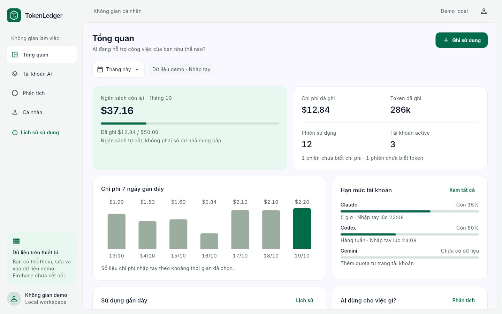

# TokenLedger — PRM393 Lab 3

Ứng dụng Flutter quản lý sử dụng AI theo tài khoản Claude, Codex, Gemini hoặc công cụ khác. Kế thừa màu, font Inter, summary card, form, grid mục đích và 4 tab của StudentPay Lab 2; có dashboard desktop mở rộng và animation.

Cập nhật tài liệu: **20/10/2026**. Repo: [NhanHuynhThien/lab3_prm](https://github.com/NhanHuynhThien/lab3_prm).



## Hiện trạng

**Khung app hoạt động bằng local demo, Firebase pending theo yêu cầu.** Google Sign-In, Firestore, FCM, Remote Config, Crashlytics, Analytics và export PDF/cloud chưa được tích hợp. Không có đăng nhập provider hoặc đồng bộ quota tự động.

Đã có:

- Dashboard responsive: ngân sách tháng, token/chi phí/số phiên, biểu đồ 7 ngày, quota, công việc gần đây và phân tích mục đích.
- Tạo, sửa, lưu trữ/khôi phục account; xóa account rỗng. Account có lịch sử được giữ để không mất phân tích.
- Ghi, sửa, xóa usage; lọc theo thời gian, account, mục đích và từ khóa; drilldown từ biểu đồ tới lịch sử.
- Quota nhập tay có cửa sổ, thời gian quan sát/reset; hiển thị stale khi quá reset.
- MVVM + Riverpod, repository interface và SharedPreferences local persistence; dữ liệu thiếu không biến thành 0.
- Animation biểu đồ/progress, cập nhật số tiền, chuyển tab/route, dialog/sheet và phản hồi nút. Custom animation tôn trọng reduced motion của hệ thống.
- Logo gốc: SVG, PNG 1024, Flutter vector widget, launcher icons Android và PWA/favicon.

## Chạy app

Môi trường đã kiểm tra: Flutter 3.47.5, Dart 3.13.4. Font Inter được bundle, không tải font ở runtime.

```sh
git clone https://github.com/NhanHuynhThien/lab3_prm.git
cd lab3_prm
flutter pub get
flutter run -d chrome --web-port 4183
```

Repo hiện private: cần tài khoản GitHub có quyền clone. Nếu port 4183 đã có release server chạy, dừng server đó hoặc chọn port khác. Không cần thư mục Lab2 trên máy để chạy app.

Chọn **Mở không gian demo**. Bản demo tạo 3 account, 12 phiên giả định; mọi thay đổi được lưu trên trình duyệt/thiết bị hiện tại. Trang Cá nhân có khôi phục hoặc xóa dữ liệu local với xác nhận. Lưu trữ local này không có xác thực user và không dành cho dữ liệu/credentials thật.

Đường dẫn `/?demo=1` mở trực tiếp không gian demo để preview/visual testing; không phải auth bypass của Firebase vì bản này chưa có Firebase.

```sh
flutter analyze
flutter test
flutter build web --release
```

Chạy web build tại máy:

```sh
python3 -m http.server 4183 --bind 127.0.0.1 --directory build/web
```

Mở [dashboard demo local](http://127.0.0.1:4183/?demo=1). Dừng server bằng Ctrl+C. Dữ liệu local gắn với origin/port trình duyệt; `flutter run` dùng port khác sẽ có bộ dữ liệu riêng.

### Android

Đã sinh cấu hình Android, applicationId `com.tokenledger.token_ledger`, tên app và launcher icon TokenLedger. Máy hiện tại **chưa có Android SDK**, nên chưa build APK hoặc kiểm thử Android native. Sau khi cài Android Studio/SDK và hoàn tất `flutter doctor`:

```sh
flutter devices
flutter run -d <android-device-id>
flutter build apk --debug
```

Không yêu cầu Firebase config để chạy local demo.

## Kiến trúc

```text
lib/
  theme/       # Lab2 tokens + dashboard extensions + motion tokens
  models/      # plain Dart account/usage/quota/schema
  services/    # repository contract, local persistence, seed, pure calculator
  viewmodels/  # Riverpod AsyncNotifier, CRUD, validation, filters/session
  screens/     # overview, accounts/forms/detail, purposes, analytics, history, profile
  widgets/     # reusable Lab2 components, brand mark, animated charts
  utils/       # USD micros parsing/formatting, dates
```

Các tổng chi phí/budget/purpose được derive tại `reporting_viewmodel.dart`; widgets không giữ công thức tài chính. Xem [kiến trúc chi tiết](docs/architecture.md).

Nối Firebase sau bằng adapter `LedgerRepository` tại bootstrap; cần bổ sung owner-scoped streams/transactions, Auth và các service Firebase theo [backlog Firebase](docs/firebase-pending.md). Local interface hiện tại là snapshot load/save cho demo, không tự biến thành backend realtime an toàn chỉ bằng đổi tên class.

## Tài liệu

- [Mục lục và trạng thái tài liệu](docs/README.md).
- [Agent instructions](AGENTS.md) và [agent workspace](.agents/README.md).
- [Nguồn UI/handoff Lab2 dùng độc lập](docs/lab2-ui-reference.md).

- [Kế hoạch đầy đủ](docs/IMPLEMENTATION_PLAN.md) và [checklist task](docs/TASK_CHECKLIST.md).
- [Trạng thái build, hướng thiết kế và visual review](docs/build-status.md).
- [Design change log](docs/design-change-log.md), [handoff gaps](docs/handoff-gaps.md).
- [Kết quả kiểm thử](docs/test-report.md), [AI implementation log](docs/implementation-ai-log.md).
- [Logo và quy tắc sử dụng](assets/brand/README.md).
- [Figma Lab2](https://www.figma.com/design/C7FiWYzVXUS8G2cnK5AGos/PRM393-Lab2-SE192382_SE192336), [handoff Lab2 đã snapshot](docs/references/lab2/source-flutter-handoff.txt).

## Skills

Đã chạy `npx --yes skills add Leonxlnx/taste-skill --agent codex --yes`, cài 13 skills vào `.agents/skills/`; nguồn khóa trong `skills-lock.json`. Dùng `design-taste-frontend` theo app-screen workflow, style `framed-sheet`, giữ palette/type từ Lab2. Các skill cài mới có sẵn cho những lượt Codex tiếp theo trong dự án.

## Quy trình phát triển và Git

Entry point cho agent là `AGENTS.md`; `.agents/project-context.md` và `.agents/workflows.md` mô tả trạng thái, invariants, cách kiểm thử và bàn giao. 13 skills đã cài nằm trong `.agents/skills/`, không phải source code sản phẩm cần sửa tùy ý.

Repo theo dõi source, lockfile, assets/brand/fonts, tài liệu, ảnh UI Lab2 gốc và evidence scaffold. Không commit `build/`, `.dart_tool/`, local Android SDK paths, signing keys hoặc credentials. Lịch sử đầu tiên phản ánh publication 20/10; không backdate tiến trình.

Repo private chưa chứng minh giảng viên có quyền truy cập; xử lý access trước ngày nộp. Chưa tạo PR hoặc hoàn tất AI PR review theo rubric.

## Giới hạn hiện tại

P0 Lab3 chưa hoàn tất: chưa Firebase/Google Auth/PDF/MobAI/AI PR review/Android device evidence. Chưa edit hoặc annotate live Figma; đã ghi thay đổi local. Chu kỳ local demo là tháng dương lịch theo timezone thiết bị, cost nhập tay USD; chưa pricing engine/cache-token normalization/import CSV/multi-window quota. Dữ liệu mẫu không phải giá hoặc hạn mức thật của nhà cung cấp. Đổi chủ đề và các thay đổi so với Lab2 cần được trình bày với giảng viên theo rubric.
