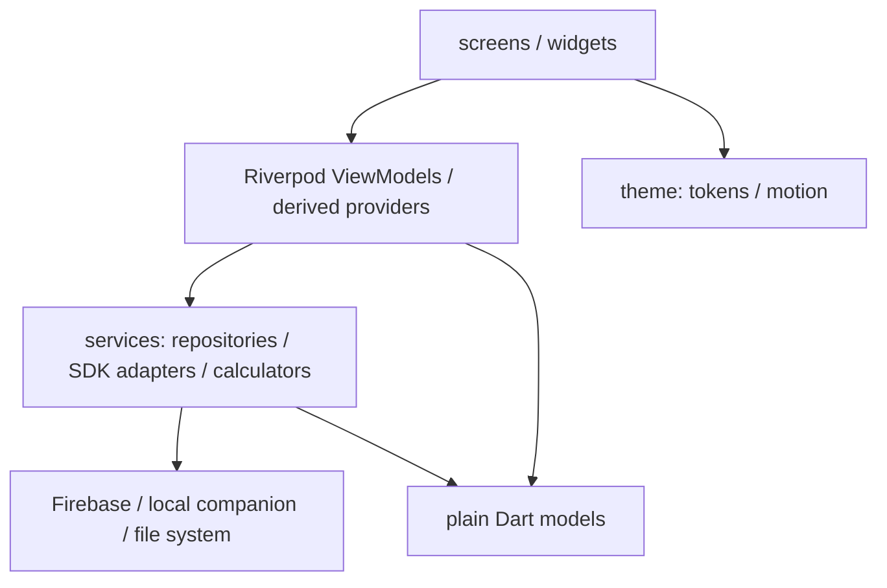
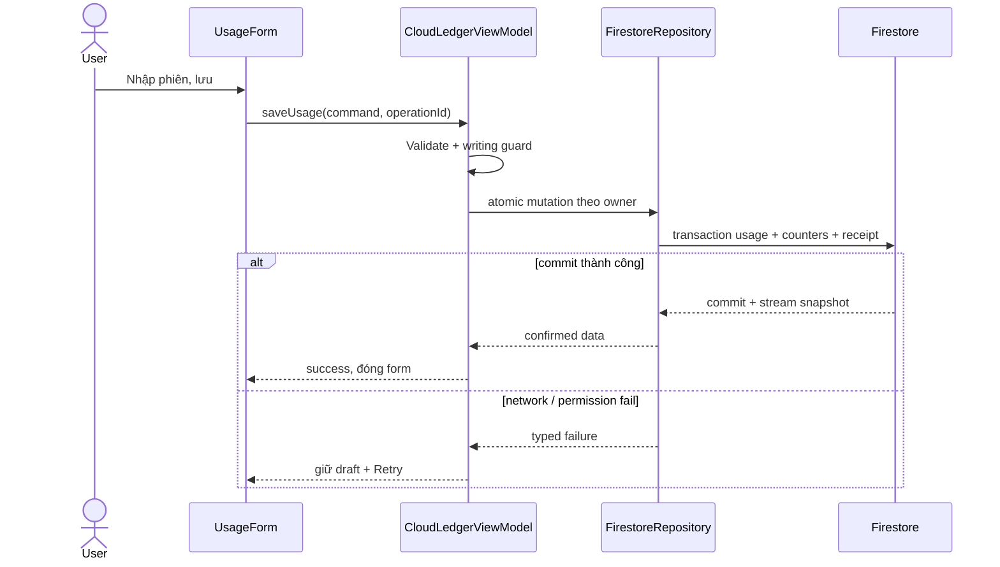

# Kiến trúc TokenLedger — source22/10/2026

Chuẩn: [PDF17trang §5](ASSIGNMENT_REQUIREMENTS.md). [Audit](requirements-audit.md) phân biệt structure đúng với separation/gates chưa đủ.

## Luồng dependency

| Folder | Source chính | Trách nhiệm |
|---|---|---|
| models | ledger,auth_session,provider_usage,export_report | immutable data/schema/nullable semantics |
| services | firebase_auth_service,firestore_ledger_store/repository/codec | Firebase SDK và persistence, owner-scoped streams/atomic commands |
| services | usage_calculator,reporting_calendar,manual_report_projection | pure aggregation/time boundaries, serialization/validation |
| viewmodels | auth_viewmodel,cloud_ledger_viewmodel,cloud_ledger_mutations | auth/data state, business commands, draft/error/retry |
| viewmodels | reporting_viewmodel,ledger_scope_viewmodel,live_clock_viewmodel | ranges/scopes/totals, quota staleness/reactive clock |
| viewmodels | product_features_viewmodel,provider_sync_viewmodel,provider_sources_viewmodel,gemini_activity_viewmodel | feature state/services and source selection/import |
| screens | 8Lab2 mapped screens + Login/Profile/Quota/ProviderConnections/Shell | render/form controls/navigation |
| widgets | common,forms,charts,provider*,notification/export panels | reusable components; legacy orchestration gaps below |
| theme/utils | app_theme,formatters | colors/type/space/radius/motion, presentation formatting |

## Bootstrap và session isolation

`main.dart` inject Auth + Analytics/RC/Crash/Notification/Storage transports. Firebase Core được Auth backend initialize trước auth stream sẵn sàng. `AuthGate` signed-out→Login; signed-in→container + navigator keyed UID. Runtime không mở SharedPreferences demo, không generate seed hoặc URL bypass. Fixtures ở `test/support/`.

Root sở hữu feature SDK session. Child workspace share **actual** services từ root, override ledger bằng CloudLedgerViewModel và owner bằng UID; không tạo default null-transport service thay SDK đã setup. Logout/changeUID dispose whole route stack, filters/drafts/cloud listeners/local provider snapshots. Report generate/upload dùng captured UID+epoch và bỏ stale completion; 3 lifecycle tests pass.

## Mapping View → VM

| View | State/commands |
|---|---|
| Login/Profile | authSessionProvider/authActionProvider; productFeaturesProvider |
| Dashboard/Accounts/AccountDetail | cloud ledger + reporting/AccountProjection providers |
| UsageForm/AccountForm/QuotaForm | shared ledger mutations + controller/draft widget state |
| Purpose | selection returned to usage form; currently no dedicated screen VM |
| Analytics/History | reporting/filter/scope providers + providerSourcesProvider |
| ProviderConnections | providerSyncProvider + geminiActivityProvider |

Mỗi screen có file riêng; **chưa one-to-one VM cho mọi screen theo câu mapping tr4**. Shared providers tránh duplicate state, nhưng Purpose và form/export widget state còn cần refactor/mapping rõ trước khi claim §5 hoàn chỉnh. Không đổi folder toàn repo chỉ để tạo VM rỗng.

## Sequence: tạo usage bằng Firestore thật

Accounts/usage/quota/settings được query/filter/orderBy + snapshots; services là nơi import Firebase. Views/VM/models không import Firebase trực tiếp (đã rg22/10). Firestore converter nằm service codec để models giữ Dart thuần.

## Ranh giới nguồn dữ liệu

- Firestore: sổ nhập tay của UID, USD integer micros, unknown giữ null; account có history archive thay hard-delete.
- Companion: quota/model stats nguồn CLI/local, scope/time/source rõ; không upload vào Firestore hoặc cộng thành invoice.
- Antigravity: official `agy /usage` quota groups; không có IDE token history/invoice.
- Gemini web: user-selected Takeout JSON→isolate→daily counts UTC30days, session memory, không chat content/credentials/mail.
- ReportManagementService: PDF generation/local cache/upload transport; **metadata chỉ RAM, chưa Firestore**, chưa hoàn chỉnh §6.4.
- FCM: foreground/open/initial transport + RAM inbox; **tap routing consumer/background handling còn thiếu**, không claim full §6.5.

## Gaps kiến trúc phải sửa

1. ExportReportDialog còn tính tổng và gọi ReportManagementService trực tiếp; chuyển calculation + export/upload state vào ReportViewModel.
2. GeminiWebImportPanel còn gọi file-picker plugin tại widget; đưa I/O vào injectable service.
3. NotificationCenter còn gọi service mutations và placeholder navigation; VM route/state cần triển khai.
4. Form/Purpose screen VM mapping chưa đủ câu yêu cầu tr4; document/refactor concrete state, không tạo lớp rỗng.
5. Report metadata còn RAM; cần owner-scoped persistence/rules trước khi hoàn chỉnh upload flow. Owner epoch xuyên await đã sửa.

Các gaps này là source review thật; unit/widget pass không xóa requirement gap.

## Firestore data contract

Mọi path dưới `users/{uid}`; owner lấy từ Auth, không nhận từ form.

| Collection/document | Vai trò |
|---|---|
| `accounts/{accountId}` | Metadata/budget/cycle/source, revision, usageCount/quotaCount |
| `usage_sessions/{usageId}` | Usage, accountId bất biến, token/cost nullable |
| `quota_windows/{quotaId}` | Snapshot quota riêng từng cửa sổ |
| `quota_labels/{labelId}` | Reservation tên quota chuẩn hóa không trùng trong account |
| `settings/reporting` | Múi giờ báo cáo có revision |
| `mutations/{operationId}` | Receipt của command đã commit để retry không nhân đôi |

Cloud envelope schemaVersion1: ownerId, revision, createdAt/updatedAt server Timestamp, lastOperationId, payload allowlist. Snapshot local legacy schemaVersion2 là định dạng khác, không tự upload/migrate vào user mới. Account cloud không chứa quota list; VM ghép quota stream trước khi render.

USD integer micros, 1USD=1000000micros; null khác0. Token input/output cùng null hoặc cùng số nguyên. Cost basis actual/manual/unspecified/unknown không tự biến thành invoice. Dates UTC, reporting theo IANA timezone và cycle1–31. Quota% không cộng giữa cửa sổ; stale không tự reset100%.

Atomic transaction đọc receipt trước; cùng operationId/intent trả kết quả trước, khác intent gây conflict. Entity/counters/label/receipt cùng commit; callback không tạo IDs, publish UI hoặc gọi dịch vụ ngoài. Edit/delete gửi expectedRevision, không upsert entity đã mất hoặc đổi accountId usage. Archive giữ history và chặn usage mới; hard delete account chỉ khi cả usageCount/quotaCount=0.

Streams filter/order theo archived, account, purpose, occurredAt `[start,end)`; giữ fromCache/hasPendingWrites, không gọi cache là server-confirmed. Retry giữ command/operationId khi kết quả chưa rõ. Account đổi UID revoke repository, cancel listeners và bỏ stale UI completion. Client guard không thay Security Rules.

Source: [repository](../lib/services/firestore_ledger_repository.dart), [codec](../lib/services/firestore_ledger_codec.dart), [SDK store](../lib/services/firestore_ledger_store.dart), [rules](../firebase/firestore.rules), [indexes](../firebase/firestore.indexes.json).
